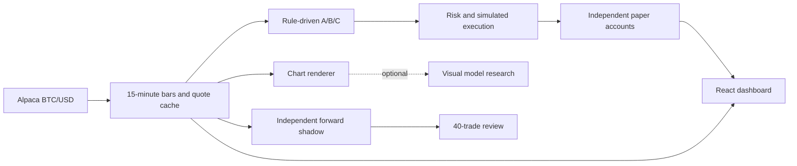

# BTC Visual Price Action Lab

[中文说明](README.zh-CN.md) | [Architecture](docs/ARCHITECTURE.md) | [Quick start](docs/QUICKSTART.md) | [Known issues](docs/KNOWN_ISSUES.md)

An experimental BTC/USD 15-minute price-action research system with three independently accounted paper traders, an isolated shadow replay and optional AI-assisted visual research. It is an internal simulator, not evidence of profitability or production trading readiness.

The current formal profile executes **rules**, not a visual model on every decision: A V2.5 examines breakout/retest, B V3.0 reversal, and C V3.1 a Tony-inspired price-action approximation. A separate vision adapter can analyze chart images using roughly 288 closed bars when explicitly configured and authorized. The forward shadow system keeps its own ledger; a 40-closed-trade threshold can initiate bounded research review, not automatic formal deployment.

The user-authorized `QUOTE_SIDE_FULL_FILL_V1` model uses bid/ask with 0.02% adverse slippage and a 0.05% fee per fill, subject to existing rounding, account and risk checks. It assumes full simulated execution and does not reconstruct actual liquidity. A/B use up to 1x; C up to 5x; the configured planned risk is 2%. Funding is not included.

The frontend uses React, TypeScript, Vite and Lightweight Charts. The backend uses Python, FastAPI and SQLite. The project includes optional DeepSeek and Alpaca integrations. No screenshot has been verified for this publication.

## Getting started

See [Windows quick start](docs/QUICKSTART.md) for dependency installation, isolated tests and local startup. The example keeps model calls and paper automation disabled. Starting the local backend initializes an empty local ledger; it is not a read-only demo. Historical market data and pre-existing private accounts are not bundled by default. A clean installation from a published checkout has not yet been verified.

## Limitations and contributions

Previously studied historical data is not an independent out-of-sample validation set. Live status, process recovery, WebSocket protection and shadow continuity have unresolved issues described in [KNOWN_ISSUES.md](docs/KNOWN_ISSUES.md). Runtime evidence may be local and is not automatically suitable for publication.

Please see [CONTRIBUTING.md](CONTRIBUTING.md) and [SECURITY.md](SECURITY.md). Do not publish credentials, private ledgers or raw provider data. Changes to strategies, risk and execution assumptions need explicit review. Licensing has not yet been selected.
