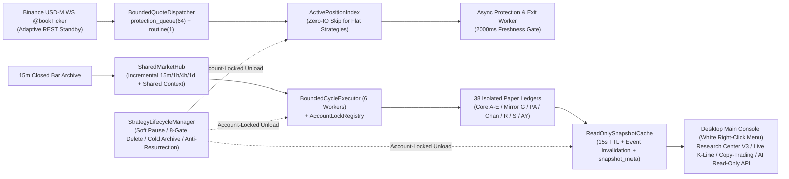

# BTC Paper Lab V3.1 (BTC Visual Price Action Lab)

[中文说明](README.zh-CN.md) | [系统架构](docs/ARCHITECTURE.md) | [新策略接入规范 (G01–G20)](docs/BTC%20Paper%20Lab%20V3.1%20新策略接入规范.md) | [38套策略文档索引](docs/strategies-38/README.md) | [Quick Start](docs/QUICKSTART.md)

An internal, rule-driven **Binance USDⓈ-M BTCUSDT** perpetual paper-trading & quantitative research platform running **38 independently accounted strategies** on a lightweight, zero-middleware Python/FastAPI/SQLite architecture.

> **Safety Notice**: Internal paper simulator (`USD_RESEARCH`, `LIVE_TRADING_DISABLED=true` in core backend). Demo and Production copy-trading services are strictly isolated, opt-in, and disabled by default for all newly onboarded strategies.

---

## Current Frozen V3.1 Architecture (`v3.1-lightweight-lifecycle`)

### 38 Active Paper Strategies (7 Dynamic Groups)
- **原有策略 (5)**：`A`, `B`, `C`, `D`, `E`
- **镜像策略 (1)**：`G` (C 反向镜像)
- **PA系列 (10)**：`PA-01`–`PA-08`（声明式策略池）+ `PA-09`, `PA-10`（隔离扩展）
- **Chan (1)**：`pa-chan-center-divergence`
- **R系列 (6)**：`R01`–`R06`（V1.1.0 冻结参数，TD Sequential 多周期）
- **S系列 (12)**：`thc-s01` / `thc-s02` / `thc-s01-s02-combo` × `15m / 1h / 4h / 1d`
- **AY系列 (3)**：`thc-ay02-15m`, `thc-ay03-15m`, `thc-ay04-15m`

---

## Core Engineering Capabilities (V3.1)

1. **Lightweight Shared Market & Incremental Computation (`backend/market_hub.py`, `strategies/thc_ay/signals.py`)**:
   - Single `SharedMarketHub` shares normalized closed 15m/1h/4h/1d bars and derived contexts (`MultiTFContextV11`) across all strategies; O(1) incremental Wilder ATR/ADX and AY ATR/ADX extension eliminates redundant full-history rebuilds.
2. **Protection-Preserving Quote Hot Path (`backend/quote_pipeline.py`)**:
   - `ActivePositionIndex` skips SQLite I/O for flat idle strategies (>90% zero-IO skips) while routing stop/target/pending triggers into a bounded FIFO `protection_queue` (zero silent drops, strict `2000ms` freshness gate, adaptive REST fallback when WS degrades).
3. **Unified Strategy Lifecycle Management (`backend/lifecycle_manager.py`, `scripts/local_dashboard.py`)**:
   - Unified **Soft Pause** across all 38 strategies (stops new entries, preserves open positions & live SL/TP exits).
   - **8-Gate Safe Delete** under per-account lock (paused, flat, no pending/fault, no Demo/Prod copy binding, no inter-strategy dependency, reconcile OK, double confirmation), immutable cold archive (`data/archived-deleted/`), dynamic resource unloading, and restart anti-resurrection (`data/strategy-lifecycle.sqlite3`).
   - Clean white-card right-click context menu in Desktop Main Console (`scripts/local_dashboard.py`) with automatic sync across Strategy Pool, Research Center V3, Live K-line, and Copy-Trading selectors.
4. **Mandatory Onboarding & Acceptance Standards (G01–G20)**:
   - See [BTC Paper Lab V3.1 新策略接入规范.md](docs/BTC%20Paper%20Lab%20V3.1%20新策略接入规范.md) for all 20 mandatory gates (`G01–G20`), including `G19` (System Resources & Scaling) and `G20` (Unified Strategy Lifecycle).

---

## Quick Start & Local Deployment (Windows)

- **Official Local Deployment Directory**: `windows-binance-deploy` (Backend `127.0.0.1:8012`, Frontend `127.0.0.1:5175`, Desktop Console `scripts/local_dashboard.py`).
- **Start / Stop**: `scripts/start_lab.ps1`, `scripts/stop_lab.ps1`, `scripts/start_backend.ps1`, `scripts/stop_backend.ps1`.
- **Ledger Backup**: `python scripts/ledger_backup.py` (hot-backs up all active SQLite ledgers).
- **Run Tests**: `.venv\Scripts\python.exe -m pytest tests/test_phase1_lightweight_architecture.py tests/test_phase2_lifecycle_management.py tests/test_phase3_scale_38_50_100_200.py tests/test_freeze_protection_and_sg7.py`

> **Repository Security Policy**: Never commit `.sqlite3`, `.sqlite3-wal`, `.sqlite3-shm`, `.dpapi`, `.env`, API credentials, live balances, or local backups.
