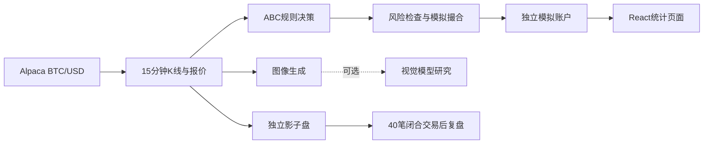

# BTC视觉价格行为量化实验室

[English](README.md) · [架构](docs/ARCHITECTURE.md) · [快速开始](docs/QUICKSTART.md) · [已知问题](docs/KNOWN_ISSUES.md)

这是使用BTC/USD 15分钟K线研究价格行为的实验项目。ABC各有独立模拟账户，影子盘使用独立账本，另有可选的AI视觉分析和研究复盘。项目尚处于实验阶段，历史模拟结果不能证明长期盈利。

当前正式模拟盘采用规则决策：A V2.5为突破回踩，B V3.0为反转，C V3.1为Tony理念裸K近似。视觉模型路径与正式规则决策分开；配置并授权后，可使用约288根已收盘K线生成的图像开展分析。影子账户每累计40笔闭合交易可触发受预算控制的研究复盘，不等于自动升级正式策略。

现有`QUOTE_SIDE_FULL_FILL_V1`假设使用买卖报价完整模拟成交，每次不利滑点0.02%、手续费0.05%，按现有规则舍入。A/B最高1倍，C最高5倍，单笔计划风险配置为2%；资金费未纳入。模拟成交不代表真实盘口成交。

后端使用Python、FastAPI和SQLite，前端使用React、TypeScript、Vite和Lightweight Charts。Windows安装及隔离测试说明见[快速开始](docs/QUICKSTART.md)：默认不开启收费模型或模拟自动调度；无凭证时行情可能不可用。启动后端会初始化本地空账本，并非只读演示。当前发布版本尚未完成全新环境安装验证，也没有经过公开检查的页面截图。

历史行情已多次用于研究，不应称为完全独立样本外。WebSocket保护恢复、Windows服务管理及影子缺周期恢复等限制见[已知问题](docs/KNOWN_ISSUES.md)。外部贡献请先阅读[贡献指南](CONTRIBUTING.md)与[安全说明](SECURITY.md)，不要提交密钥、私有账本或原始行情账户资料。许可证尚未选定。
