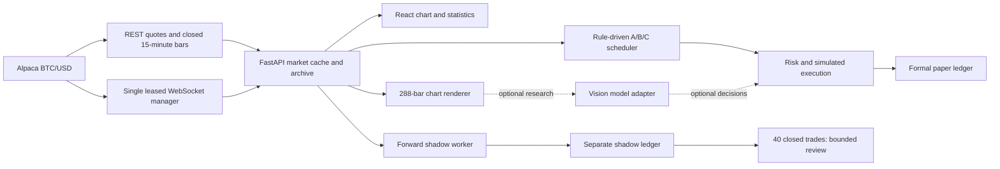

# Architecture

The current formal profile is rule-driven; visual inference is separate and must not be presented as the source of each formal decision. Shadow consumes the local API and maintains its own ledger. Review generation, historical comparisons and promotion are distinct; automatic deployment to formal accounts is not established. See [known issues](KNOWN_ISSUES.md).
