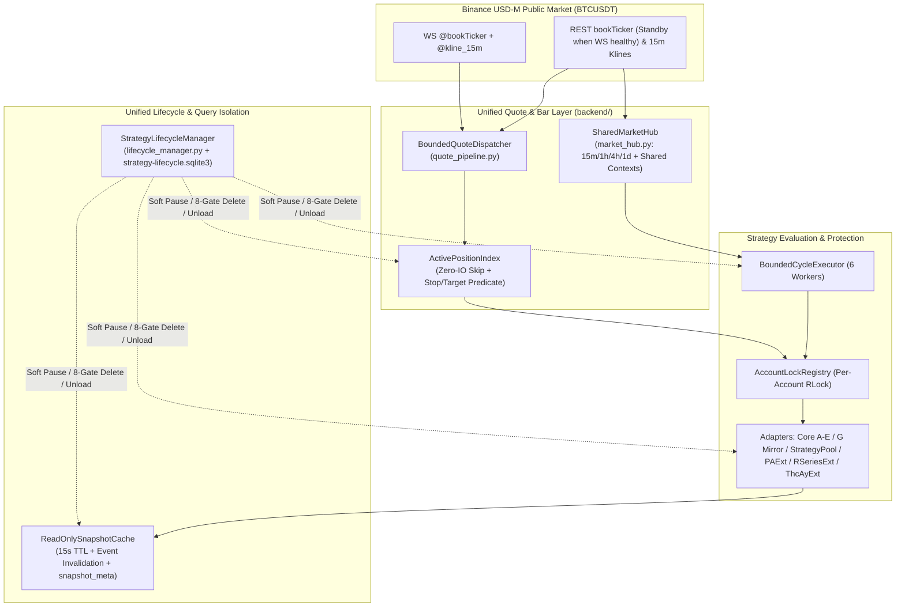

# BTC Paper Lab V3.1 System Architecture

> Frozen Baseline Tag: `v3.1-lightweight-lifecycle`
> Design Philosophy: **Lightweight, zero-middleware (no Redis/Kafka/microservices), single-backend shared market hub, per-account ordering, protection-first hot path, and unified strategy lifecycle.**

---

## 1. High-Level Runtime Topology

| Process | Entrypoint | Port / Role |
| :--- | :--- | :--- |
| **Core Backend** | `uvicorn backend.app:app --host 127.0.0.1 --port 8012` | Market ingestion, 38-strategy scheduling & SL/TP protection, SQLite ledgers, REST/WS APIs |
| **Web Frontend** | `frontend/` (Vite + React + Lightweight Charts) | `127.0.0.1:5175` Live K-line & web observation views |
| **Desktop Console** | `scripts/local_dashboard.py` | Main operator console (dynamic 7-group tabs, white right-click lifecycle menu, Research Center V3, Strategy Pool, Live K-line launcher) |
| **Copy-Trading Service** | `scripts/live_copy_service.py` (opt-in, isolated) | Read-only SQLite fill follower for authorized Demo / Production Binance USDⓈ-M copy accounts |

---

## 2. Core Data & Control Flow

---

## 3. Key Modules & Responsibilities

- **`backend/market.py` & `backend/common_guard.py`**: Single Binance USDⓈ-M public market client, strict `2000ms` quote freshness gate (`COST_MODEL.max_quote_age_ms`), and unified `CommonMarketGuard` + unified Chinese action/status mapping.
- **`backend/market_hub.py`**: `SharedMarketHub` (incremental 15m bar append, cached 1h/4h/1d aggregation, shared derived contexts), `AccountLockRegistry` (per-strategy atomic locking + `remove()` on unload), `BoundedCycleExecutor` (6-worker isolated fan-out), and `ReadOnlySnapshotCache` (event-invalidated TTL cache with `snapshot_meta` for Console, Research Center, and AI read-only APIs).
- **`backend/quote_pipeline.py`**: `accept_quote_update()` anti-stale/anti-regressive quote contract, `ActivePositionIndex` (skips SQLite I/O for flat strategies while immediately routing stop/target/pending triggers), and `BoundedQuoteDispatcher` (bounded FIFO `protection_queue` + 1-slot routine coalescing + overload latch).
- **`backend/lifecycle_manager.py`**: `LifecycleRegistry` (`data/strategy-lifecycle.sqlite3` minimal metadata/tombstone store) & `StrategyLifecycleManager` (unified Soft Pause, Resume, Archive, 8-Gate Safe Delete under account lock, immutable cold archive under `data/archived-deleted/`, restart anti-resurrection, Restore, and Explicit Re-register).
- **Strategy Adapters**:
  - Core: `backend/rule_cycle.py`, `backend/d_bridge.py`, `backend/e_auto_cycle.py`, `backend/g_mirror.py`, `backend/strategy_control.py`
  - Mode A Pool: `backend/strategy_pool.py` (PA-01..08 + Chan, bounded 500-row diagnostics retention)
  - Mode B Isolated Extensions: `backend/pa_extension.py` (PA-09/10), `backend/r_series_extension.py` (R01–R06 V1.1.0), `backend/thc_ay_extension.py` (12 S-series + 3 AY-series with O(1) incremental `ThcAyCycleContext`).

---

## 4. Mandatory Specifications (For Future Codex / Gemini Handoffs)

1. [BTC Paper Lab V3.1 新策略接入规范.md](BTC%20Paper%20Lab%20V3.1%20新策略接入规范.md) — Complete **G01–G20** onboarding, resource/scaling (`G19`), and lifecycle (`G20`) acceptance gates.
2. [BTC V3统一行情保护与退出保护规范V1.0.md](spec/BTC%20V3统一行情保护与退出保护规范V1.0.md) — Market freshness, unified exit protection, adaptive REST fallback, and soft-pause continuity.
3. [BTC Paper Lab V3.1 统一策略研究数据接口规范.md](BTC%20Paper%20Lab%20V3.1%20统一策略研究数据接口规范.md) — Read-only research metrics, `snapshot_meta`, and lifecycle sync contract.
4. [codex.md](../codex.md) — Chronological engineering memory and verified lessons learned.
